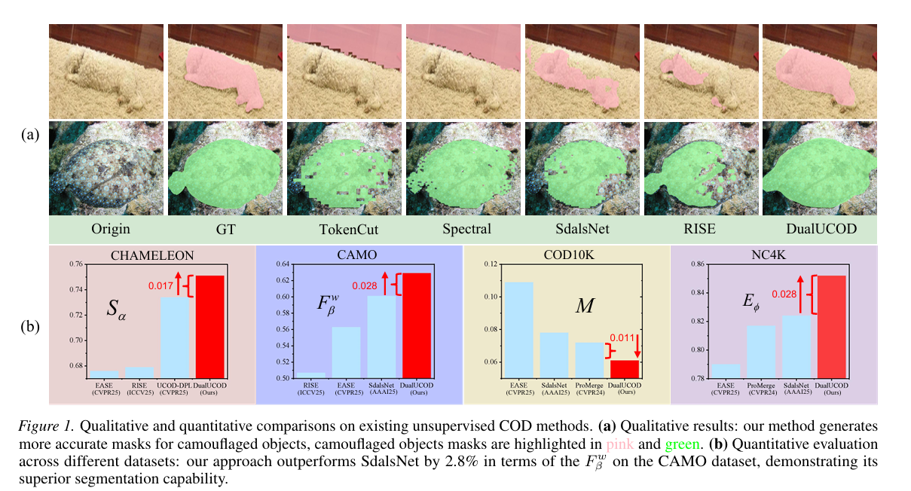

# DualUCOD
**Unsupervised Camouflaged Object Detection with Dual-Eigenvector Spectral Pseudo-Labeling and Contrastive Refinement**,  ICML 2026

#### Authors
Pingzhu Liu, Chunming He, Zunnan Xu, Chao Hao, Bo Zhao, Xingyu Shao, Jun Zhou, Zitong YU, Xiu Li.
---
> **Abstract:** *Unsupervised Camouflaged Object Detection (UCOD) aims to identify objects concealed in their surroundings without relying on pixel-level labels. Existing methods rely solely on simple post-processing of DINO high-dimensional features to generate pseudo labels for training. However, these methods suffer from two major limitations: 1) pseudo labels they easily generate contain excessive noise, causing the model to learn substantial incorrect information. 2) Although pseudo-label supervision allows the model to understand the task, it remains insufficient for generating fine-grained segmentation of the camouflaged objects. To address these issues, we propose DualUCOD, a novel UCOD method based on dual-branch contrastive learning that effectively detects camouflaged objects without pixel-level labels. Specifically, we propose the Dual-Eigenvector Spectral Pseudo-Labeling (DESPL) strategy, which fuses semantic and color cues into an affinity matrix. We then compute the eigenvectors of its normalized graph Laplacian and generate high-quality pseudo-labels using these eigenvectors. Furthermore, we introduce a Boundary-Guided Foreground-Background Refinement (BGFBR) module that explicitly incorporates boundary information to improve segmentation accuracy. Finally, we introduce a Dual-Branch Contrastive Learning (DBCL) module that constructs positive and negative pairs from the original and augmented images, aligning positive representations while contrasting them against negatives to enhance camouflaged object understanding. Extensive experiments demonstrate that DualUCOD outperforms state-of-the-art methods on different datasets in the unsupervised setting.*
>
> <p align="center">
> 
> </p>
---

## Usage


### 1. Prerequisites

> Note that Model is only tested on Ubuntu OS with the following environments.

- Creating a virtual environment in terminal: `conda create -n DualUCOD python=3.9`.
- Installing necessary packages: `pip install -r requirements.txt`

### 2. Downloading Training and Testing Datasets

- Download the [training set](https://anu365-my.sharepoint.com/:u:/g/personal/u7248002_anu_edu_au/EQ75AD2A5ClIgqNv6yvstSwBQ1jJNC6DNbk8HISuxPV9QA?e=UhHKSD) (COD10K-train) used for training 
- Download the [testing sets](https://anu365-my.sharepoint.com/:u:/g/personal/u7248002_anu_edu_au/EVI0Bjs7k_VIvz4HmSVV9egBo48vjwX7pvx7deXBtooBYg?e=FjGqZZ) (COD10K-test + CAMO-test + CHAMELEON + NC4K ) used for testing

### 3. Stage I: Pseudo-Label Generation

The model is trained in two stages. First, generate pseudo labels from the unlabeled training images using DESPL (Eqs. (1)-(10) and Appendix A.3 of the paper):

```bash
python GeneratePseudoLabels.py --data_path YOUR_TRAININGSETPATH/Imgs --save_path YOUR_TRAININGSETPATH/PseudoMask_Enhanced --device cuda --imgsz 476
```

The generator uses the paper's DINOv2 ViT-L/14 settings and eight-view fusion without ground-truth masks. It saves original-resolution soft pseudo labels matching Eq. (10). Pretrained weights are downloaded on first use; `--weights PATH` loads a local backbone state dict. See `python GeneratePseudoLabels.py --help` for options.

### 4. Stage II: Model Training

After Stage I, train the model with the generated masks in `YOUR_TRAININGSETPATH/PseudoMask_Enhanced/`:

```bash
python Train.py --epoch 50 --lr 3e-4 --batchsize 16 --trainsize 476 --train_root YOUR_TRAININGSETPATH/ --val_root YOUR_VALIDATIONSETPATH/ --save_path YOUR_CHECKPOINTPATH/
```

### 5. Testing Configuration

Please change the file path in the corresponding code.
```bash
python Test.py  --testsize YOUR_IMAGESIZE  --pth_path YOUR_CHECKPOINTPATH  --test_dataset_path  YOUR_TESTINGSETPATH
```

### 6. Evaluation

- Matlab code: One-key evaluation is written in [MATLAB code](https://github.com/DengPingFan/CODToolbox), please follow this the instructions in `main.m` and just run it to generate the evaluation results.

### 7. Results download

The prediction results of our DualUCOD are stored on [Baidu Drive](https://pan.baidu.com/s/1rYmeua5jLtIq1WIhW7vrYw?pwd=9h9v) please check.


## Related Works
[Weakly-Supervised Concealed Object Segmentation with SAM-based Pseudo Labeling and Multi-scale Feature Grouping](https://arxiv.org/abs/2305.11003), arxiv 2023.

[Feature Shrinkage Pyramid for Camouflaged Object Detection with Transformers](https://github.com/ZhouHuang23/FSPNet), CVPR 2023.

[Concealed Object Detection](https://github.com/GewelsJI/SINet-V2), TPAMI 2022.

You can see more related papers in [awesome-COD](https://github.com/visionxiang/awesome-camouflaged-object-detection).
## Citation
If you find our work useful in your research, please consider citing:
```
@inproceedings{Liu2026Camouflaged,
title={Unsupervised Camouflaged Object Detection with Dual-Eigenvector Spectral Pseudo-Labeling and Contrastive Refinement},
author={Pingzhu Liu, Chunming He, Zunnan Xu, Chao Hao, Bo Zhao, Xingyu Shao, Jun Zhou, Zitong YU, Xiu Li},
booktitle={ICML},
year={2026}
}
```

## Concat
If you have any questions, please feel free to contact me via email at kevin_ailover@163.com.

## Acknowledgement
The code is built on [FEDER](https://github.com/ChunmingHe/FEDER). Please also follow the corresponding licenses. Thanks for the awesome work.
